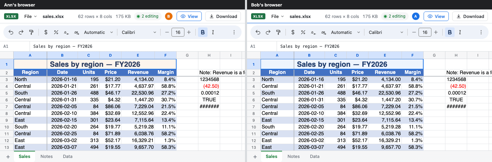
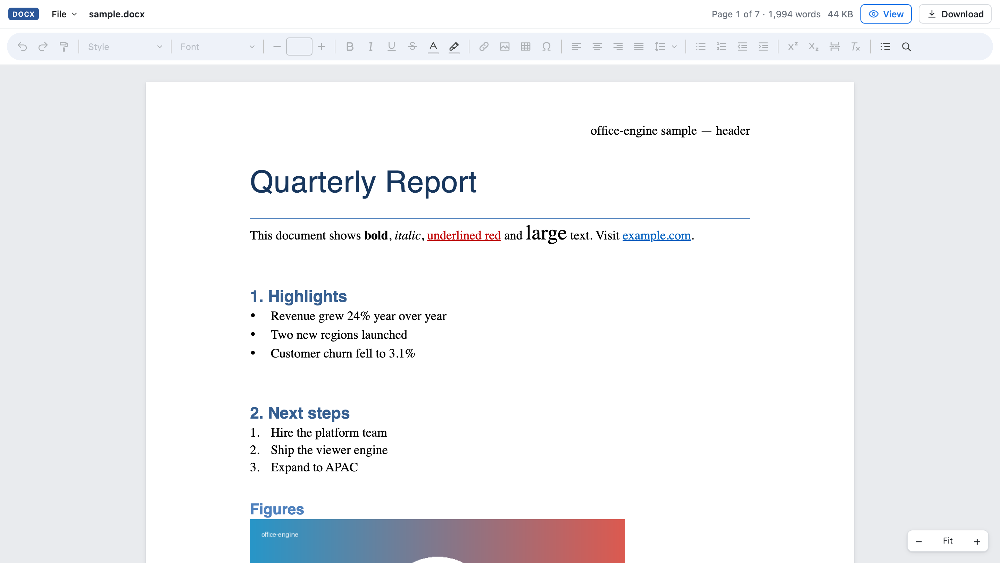
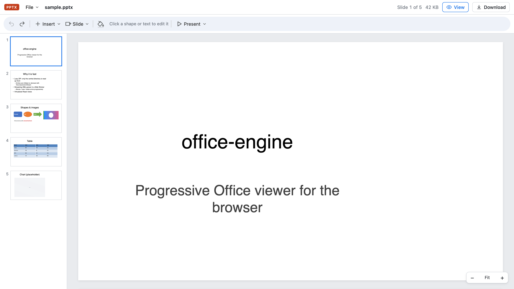

# @p10node/office-engine

[](https://www.npmjs.com/package/@p10node/office-engine)
[](https://www.npmjs.com/package/@p10node/office-engine)
[](https://github.com/p10node/office-engine/actions/workflows/ci.yml)
[](LICENSE)

View + edit **DOCX / XLSX / PPTX** directly in the browser. Loads progressively like Google Docs, handles heavy files, one-line React embed, saves back to the original format.

**[npm](https://www.npmjs.com/package/@p10node/office-engine)** · **[Live demo](https://p10node.github.io/office-engine/demo/)** · **[Docs](https://p10node.github.io/office-engine/)**

The demo has samples, heavy files (300k-row sheet, 305-slide deck), drag & drop your own file, edit and download.

**Real-time collaboration**



**300k-row XLSX open in the browser**


| DOCX editor                               | PPTX editor                               |
|-------------------------------------------|-------------------------------------------|
|  |  |

## Install

```bash
bun add @p10node/office-engine   # peer: react >= 18, react-dom >= 18
```

## Usage

```tsx
import { DocViewer } from '@p10node/office-engine'

<DocViewer src={file} style={{ height: 600 }} />                 // File | Blob | ArrayBuffer | Uint8Array
<DocViewer src="https://cdn.example.com/report.xlsx" />          // URL → Range requests
<DocViewer src={file} editable onSave={(blob, name) => upload(blob, name)} />
```

CSS is auto-injected. Container must have a height.

Without React:

```html
<script src="office-engine.embed.js"></script>   <!-- dist/, bundles React + worker -->
<office-viewer src="/files/report.docx" style="height:600px"></office-viewer>
```

## Docs

Also online at [p10node.github.io/office-engine](https://p10node.github.io/office-engine/).

- [Features](docs/features.md): format coverage, editing, saving, limitations
- [API](docs/api.md): props, custom views, `mount()`, `<office-viewer>`, core API, CSP
- [Real-time collaboration](docs/collaboration.md)
- [Development](docs/development.md): playground, architecture, demo deploy, release

## Features

- **Progressive loading**: lazy ZIP, HTTP Range requests, streaming XML parser in a Web Worker → UI never blocks
- **Virtualized views**: only visible pages, cells and slides render
- **Editing** with a Google Docs-style toolbar: DOCX text, styles, lists, images, tables; XLSX cells, formulas (134 functions), formats, borders, rows/columns, sheets; PPTX text, shapes, images, slides, slideshow
- **Fast save**: only edited parts are regenerated, everything else keeps its original bytes
- **File menu**: new, open (also CSV / text / Markdown / HTML), import CSV, rename, download as PDF / HTML / text / CSV, document details, print
- **Real-time collaboration**: live edits, avatars, collaborators' cursors, offline edits sync on reconnect
- **Dark mode**: `theme="dark"` or `"auto"` (follows the OS); documents keep their own colors
- **Embed anywhere**: React component, hook, vanilla `mount()`, `<office-viewer>` web component, single `<script>` file

Full list, format coverage and limitations: [Features](docs/features.md).

| File                     | Size    | First paint | Fully loaded      |
|--------------------------|---------|-------------|-------------------|
| DOCX 20k paragraphs      | 1.2 MB  | ~180 ms     | 2073 pages in ~2s |
| XLSX 300k rows × 12 cols | 24.8 MB | ~330 ms     | ~2s               |
| PPTX 305 slides          | 0.3 MB  | ~110 ms     | on-demand         |

Measured in headless Chromium on Apple M-series.

## License

[MIT](LICENSE) © p10node
