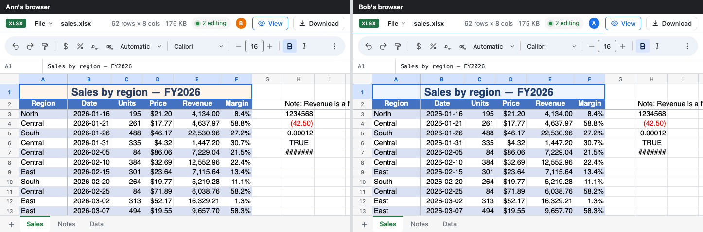
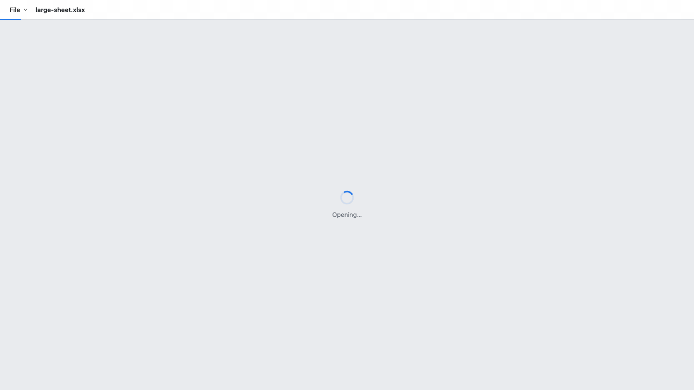
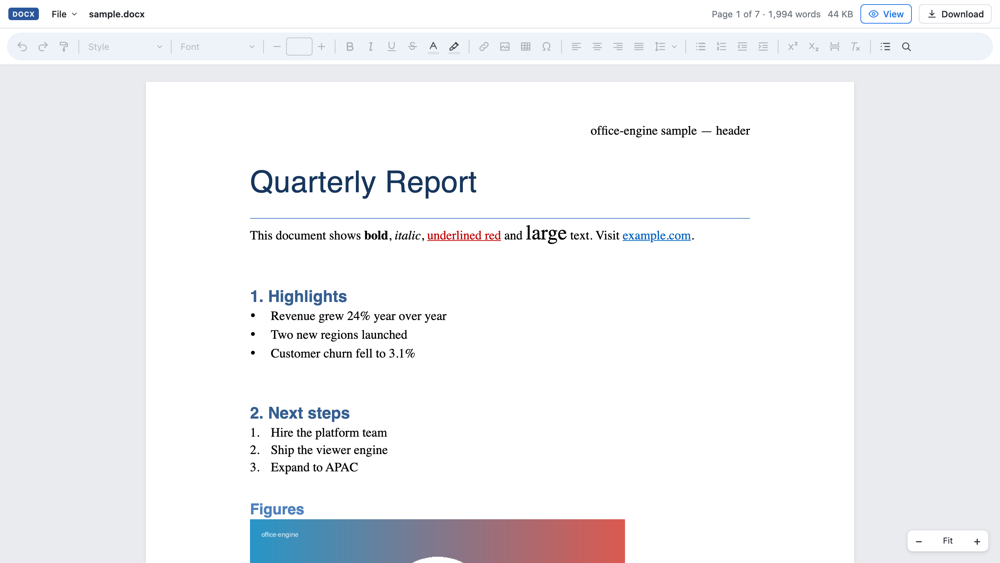
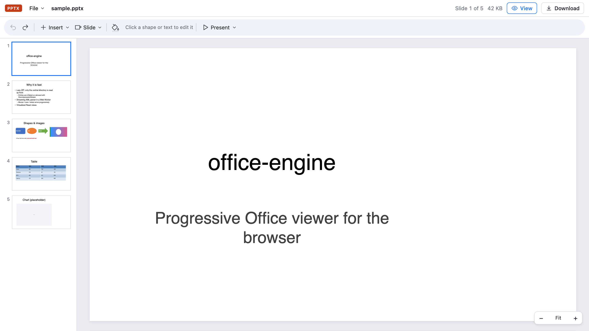

# @p10node/office-engine

[](https://www.npmjs.com/package/@p10node/office-engine)
[](https://www.npmjs.com/package/@p10node/office-engine)
[](https://github.com/p10node/office-engine/actions/workflows/ci.yml)
[](LICENSE)

View + edit **DOCX / XLSX / PPTX** directly in the browser, open and edit **DOC / XLS / PPT** (Office 97-2003), **RTF** and **OpenDocument** (ODT / ODS / ODP), view Apple **Pages**, **Keynote** and **Numbers** files, Microsoft **Visio** drawings and **e-mail** messages (`.eml`, Outlook `.msg`), open **CSV**, text, Markdown, HTML and SVG as editable sheets / documents and source code with syntax colors, and draw **Mermaid**, **PlantUML** and **Graphviz** diagrams (no server, no extra library). Loads progressively like Google Docs, handles heavy files, one-line React embed, saves back to the original format.

**Zero runtime dependencies, zero servers.** Parsing, layout, formulas, diagrams and ZIP are all in the library, running in a Web Worker: nothing leaves the browser.

**Open a 55 GB CSV in a browser tab.** There is no row limit: the first screen shows in seconds, 12 million cells stay in memory and every other row is read from the file the moment it scrolls into view. 500 million rows × 10 columns (55 GB) open in ~4.5 min in Chrome, 100 million (10.6 GB) in ~50 s, and the tab stays under 1 GB of memory either way, whether the file has one million rows or five hundred. XLSX goes to Excel's full 1,048,576 × 16,384 (300k rows open in ~2.5 s), DOCX to thousands of pages, PPTX to hundreds of slides.

**[npm](https://www.npmjs.com/package/@p10node/office-engine)** · **[Live demo](https://p10node.github.io/office-engine/demo/)** · **[Docs](https://p10node.github.io/office-engine/)**

The demo has samples, heavy files (300k-row sheet, 305-slide deck), drag & drop your own file, edit and download.

**Real-time collaboration**



**300k-row XLSX open in the browser**



| DOCX editor                               | PPTX editor                               |
|-------------------------------------------|-------------------------------------------|
|  |  |

## Install

```bash
bun add @p10node/office-engine   # peer: react >= 18, react-dom >= 18
```

## Usage

```tsx
import { DocViewer } from '@p10node/office-engine'

<DocViewer src={file} style={{ height: 600 }} />                 // File | Blob | ArrayBuffer | Uint8Array
<DocViewer src="https://cdn.example.com/report.xlsx" />          // URL → Range requests
<DocViewer src={file} editable onSave={(blob, name) => upload(blob, name)} />
```

CSS is auto-injected. Container must have a height.

Without React:

```html
<script src="office-engine.embed.js"></script>   <!-- dist/, bundles React + worker -->
<office-viewer src="/files/report.docx" style="height:600px"></office-viewer>
```

## Docs

Also online at [p10node.github.io/office-engine](https://p10node.github.io/office-engine/).

- [Features](docs/features.md): format coverage, editing, saving, browsers, limitations
- [API](docs/api.md): props, custom views, `mount()`, `<office-viewer>`, core API, CSP
- [Theming](docs/theming.md): design tokens, light / dark, loading the stylesheet yourself
- [Real-time collaboration](docs/collaboration.md)
- [Development](docs/development.md): playground, architecture, demo deploy, release

## Features

- **Progressive loading**: lazy ZIP, HTTP Range requests, streaming XML parser in a Web Worker → UI never blocks
- **Virtualized views**: only visible pages, cells and slides render
- **DOCX pages cut like Word's**: a paragraph goes on at the top of the next page between two lines, a table between two rows with its header rows repeated; widow / orphan control, keep with next, keep lines together; editing goes on across the page end
- **Editing** with a Google Docs-style toolbar: DOCX text, styles, lists, images, tables; XLSX cells, formulas (540+ functions of Excel and Google Sheets, dynamic arrays, `LET` / `LAMBDA`), formats, borders, rows/columns, sheets; PPTX text, shapes, images, slides, slideshow
- **Fast save**: only edited parts are regenerated, everything else keeps its original bytes
- **Word, Excel and PowerPoint 97-2003, RTF, OpenDocument**: `.doc` / `.xls` / `.ppt`, `.rtf` and `.odt` / `.ods` / `.odp` (also templates and flat XML) are converted in the worker to DOCX / XLSX / PPTX and open **editable**: styles, lists, tables, pictures, headers and footers, notes and comments; formulas with their values, number formats, merged cells, frozen panes; masters, shapes, text and pictures of slides. Saved as `.docx` / `.xlsx` / `.pptx`
- **Apple Pages, Keynote and Numbers (view only)**: `.pages` / `.key` / `.numbers` files open read-only, converted to Word / PowerPoint / Excel in the worker (styles, lists, tables, images, shapes, header/footer, footnotes, master slides, typed and formatted cells); *Download as* Word / PowerPoint / Excel saves the converted file
- **Microsoft Visio (view only)**: `.vsdx` drawings (also `.vsdm`, templates and stencils) open read-only, a slide per page: shapes with their geometry (lines, arcs, ellipses, Béziers, NURBS), masters, groups, connectors with line ends, fills, gradients, themes, text, pictures, background pages and layers; *Download as* PowerPoint saves the converted file
- **E-mail messages (view only)**: `.eml` (also Apple Mail's `.emlx`) and Outlook `.msg` / `.oft` files open read-only as a document: subject, sender, recipients, date, the HTML (tables, the pictures the message carries), rich-text (Outlook's compressed RTF) or plain-text body, attached messages; attachments are listed and saved from the File menu. Pictures from the web are never fetched
- **CSV, text, Markdown, HTML, SVG**: `.csv` / `.tsv` open as a workbook (streamed: a million rows in about 2 s; past 12 million cells the rows are read from the file as they are shown, so there is no row limit), `.txt` / `.md` / `.html` as a document, `.svg` / `.svgz` as a picture (`.gz` files are unpacked first), from any `src` (file, Blob, URL); format from the extension, MIME type or content; UTF-8 / UTF-16 / Windows-1252; editable. Markdown, HTML and SVG are saved back in their own format (CSV and text as `.xlsx` / `.docx`)
- **Diagrams as code**: `.mmd` (Mermaid), `.puml` (PlantUML), `.dot` / `.gv` (Graphviz) open as a document with the drawing; ` ```mermaid ` / ` ```plantuml ` / ` ```dot ` blocks in Markdown and `<pre class="mermaid">` in HTML are drawn too. Drawn by a built-in layout engine in the worker: no server, no network, no dependency
- **Math in Markdown**: `$…$` and `$$…$$` TeX formulas are drawn as equations (the browser's own MathML: selectable, read by screen readers, printed); the document stays editable around them and saves each formula back exactly as it was written. Currency (`$5 and $10`), `\$` and code are left alone; a formula that cannot be read shows its source. *Download as* Word gives real Word equations
- **Code side by side**: Markdown, HTML, SVG and diagram files show their source next to the document (**Code** button); edit it and the document is rebuilt as you type; edit the document and the Markdown / HTML is built again from it
- **Syntax highlighting**: Markdown code blocks are colored by their fence's language (JavaScript / TypeScript / JSX, JSON, Python, CSS, HTML / XML, YAML, shell, SQL, Go, Rust, Java, C / C++ / C#, and more), stay editable, and are saved back with their language and exact code; the colors are only drawn, never stored. Source files (`main.ts`, `script.py`, `config.json`…, or any text with the `language` prop) open in a **code view** with line numbers, in light and dark, editable and saved as plain text. One built-in tokenizer, no dependency ([Features](docs/features.md#syntax-highlighting))
- **File menu**: new, open (also DOC / XLS / PPT / RTF / OpenDocument / Pages / Keynote / Numbers / Visio / e-mail / CSV / text / Markdown / HTML / SVG / diagrams / source code), import CSV, rename, download as PDF / HTML / text / CSV, document details, print
- **Comments**: threads with replies, resolve, edit / delete, @mentions; on DOCX text, XLSX cells and PPTX slides, stored in the file the way Word, Excel and PowerPoint store them
- **Real-time collaboration**: live edits, avatars, collaborators' cursors, offline edits sync on reconnect
- **Fonts**: hand the viewer font files (the OFL fallbacks Carlito, Caladea, Liberation, or the originals) and documents are laid out once they are loaded, so lines and pages break as with the fonts the document names ([API](docs/api.md#fonts))
- **Dark mode and theming**: `theme="dark"` or `"auto"` (follows the OS), or a theme object with design tokens for colors, type and shape ([Theming](docs/theming.md)); documents keep their own colors
- **Translatable UI**: every text of the bars, menus and dialogs from one typed table; only English bundled by default; German available through an optional import with `de-DE` formatting (see [UI texts](docs/api.md#ui-texts)); any text replaceable through `strings`
- **Numbers typed in a locale**: `locale="de-DE"` reads `1,5` and `1.234,5` typed into cells and fields (font size, margins); the whole entry or nothing, saved as the number itself, formulas unchanged ([API](docs/api.md#numbers-typed-in-a-locale))
- **Embed anywhere**: React component, hook, vanilla `mount()`, `<office-viewer>` web component, single `<script>` file

Full list, format coverage and limitations: [Features](docs/features.md).

| File                                 | Size    | First paint | Fully loaded       |
|--------------------------------------|---------|-------------|--------------------|
| DOCX 20k paragraphs                  | 1.2 MB  | ~320 ms     | 2012 pages in ~3 s |
| CSV 1M rows × 10 cols                | 99.1 MB | ~390 ms     | ~2.7 s             |
| CSV 25M rows × 10 cols (rows paged)  | 2.61 GB | ~400 ms     | ~14 s              |
| CSV 100M rows × 10 cols (rows paged) | 10.6 GB | ~690 ms     | ~50 s              |
| CSV 500M rows × 10 cols (rows paged) | 55 GB   | ~2.8 s      | ~4.5 min           |
| XLSX 300k rows × 12 cols             | 24.8 MB | ~320 ms     | ~2.5 s             |
| PPTX 305 slides                      | 0.3 MB  | ~210 ms     | on-demand          |

Measured in headless Chromium on an Apple M1 Pro (November 2026), from the moment the file is given to a viewer already on the page, read from a URL. The 100M and 500M rows are from an earlier measurement.

## Standalone packages

The renderers also ship on their own, to show diagrams and Markdown in any page without the viewer: no DOM needed, no server, no dependency.

| Package                                  | For                                                                 | Size (gzip) |
|------------------------------------------|---------------------------------------------------------------------|-------------|
| [`@p10node/diagram`](packages/diagram)   | Mermaid, PlantUML and Graphviz; draws every diagram block of a page | 40 KB       |
| [`@p10node/mermaid`](packages/mermaid)   | Mermaid → SVG                                                       | 28 KB       |
| [`@p10node/plantuml`](packages/plantuml) | PlantUML → SVG (no Java)                                            | 32 KB       |
| [`@p10node/graphviz`](packages/graphviz) | Graphviz DOT → SVG (no WebAssembly)                                 | 17 KB       |
| [`@p10node/markdown`](packages/markdown) | Markdown → safe HTML, diagrams drawn, code colored, TeX as MathML   | 66 KB       |

```ts
import { render } from '@p10node/mermaid'
document.getElementById('out')!.innerHTML = render('graph LR\n  A --> B').svg
```

## License

[MIT](LICENSE) © p10node
