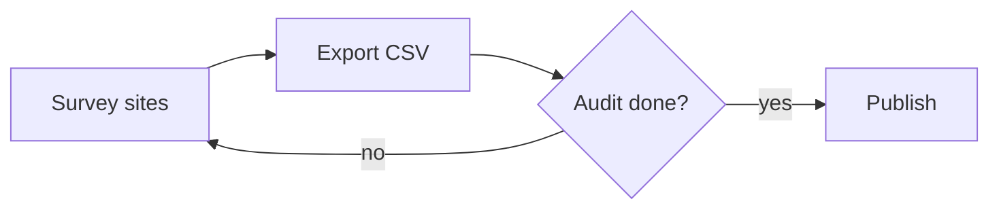

# Field notes

Opened from a **Markdown** file: headings, lists, *emphasis*, `code` and [links](https://p10node.github.io/office-engine/) become a Word document.

## Checklist

- Survey the northern sites
- Compare against last quarter
- Send the summary to the team

## Steps

1. Export the readings as CSV
2. Open them in the viewer
3. Save as Excel

| Site  | Readings | Status |
|-------|----------|--------|
| North | 1280     | done   |
| South | 2150     | open   |

> Numbers are preliminary until the audit closes.

## Process

Diagram code blocks (Mermaid, PlantUML, Graphviz) are drawn:

